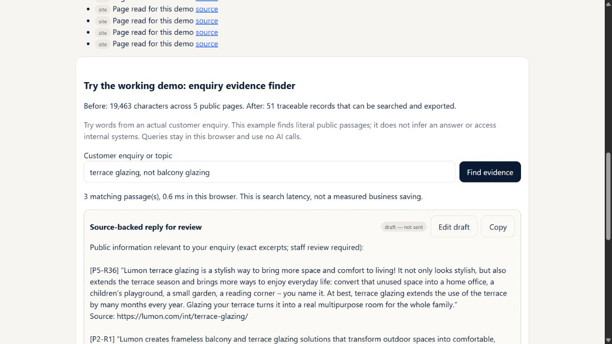

# Velho: skeptical employee/judge review of 14 methods

Assessor: gpt-6.1-sol via Codex, 2026-10-25. Review stage only: no product fixes, outreach, bookings, publication or deployment changes. Personalised media/video and the newer song seed are excluded. Oskar-approved, labelled synthetic CRM/project notes are legitimate demo inputs; their origin is not a deduction.

**Revised assessment: 93/140, average 6.64/10; 3/14 at least 8.** The constructive assessment was 126/140. These are reasoned prototype-readiness judgments, not measured reliability percentages, an official Velho judgment, or winning odds. More methods and novelty can help the innovation half of the brief; they do not establish Monday usefulness. No deduction requires sending real outreach.

## Evidence boundary

- `reproduce.ts` imports actual app functions/routes and runs controlled provider replies/failures against a newly created isolated SQLite database. All 10 negative cases and one positive control reproduced on the final run. `reproduced.json` contains results and time. These demonstrate application behavior under supplied inputs; they do not estimate how often live models produce those inputs.
- Fresh browser checks used the already approved protected tunnel. Proof query handling and Ghost calculator/edit/reload behavior were observed live. Screenshots and accessibility transcripts are in this directory.
- Other assessments inspect source and previously saved real generation artifacts. They are explicitly identified below. Previous Haiku runs are reused, not represented as new live model trials. No new model or tool installation was needed for these reproductions.
- Current talk mining was added after the constructive assessment. Its new attribution/date risks are included; its old 9/10 cannot validate the changed route.
- Original constructive results remain in `../READINESS_14.md` and `../readiness-14.json`. Passing those structural/route checks remains useful evidence, but does not negate the counterexamples here. In particular, the final acceptance script tested mostly Kesko, counted campaign themes, checked source-array presence and tested a particular conflict pattern; it did not establish broad semantic accuracy or employee usefulness.

## Scores

Same five dimensions as the constructive review, each 0–2: input/source fidelity (S), job completion (J), recovery (R), employee usability (U), traceability (T). Dimensions measure sufficiency of the demonstrated workflow, including its known bounds. An 8 is a useful bounded prototype; a 10 needs stronger representative evidence than the earlier two perfect scores had.

| Method | Previous | Revised | S,J,R,U,T | Main reason |
|---|---:|---:|---|---|
| Quiz + industry index | 8 | 6 | 1,1,1,1,2 | Indicator ignores supplied actual workload; tiny industry evidence sample cannot answer adoption prevalence. |
| Campaign | 9 | 7 | 1,2,1,1,2 | Editable tested content is retained, but the comparison labels the original generated hook; summary-level claim checks and one repair remain limited. |
| Proof before pitch | 10 | 8 | 2,1,2,1,2 | Reliable traceable keyword lookup, but excludes neither negated topics nor irrelevant mixed passages; staff still constructs the answer. |
| Signals | 9 | 6 | 1,1,1,1,2 | Upcoming triggers excluded; eight stale news items can crowd out a current registry change before evaluation. |
| Trade fair companion | 9 | 8 | 1,2,2,1,2 | Useful company/notes-to-follow-up flow and manual fallback; varied booth recognition and live camera use remain unverified. |
| Talk-to-pipeline | 10 | 6 | 2,1,0,1,2 | Provider outage prevents lead persistence; repeat visitors fragment and the latest-200 window has no working pagination. |
| Buyer simulator | 9 | 8 | 1,2,2,1,2 | Useful report-grounded text practice; literal transcript citations validate words, not the quality/calibration of the subjective score. |
| Dead-deal resurrector | 9 | 7 | 1,1,2,1,2 | Valid post-contact signals do not establish that the old objection changed; saved opener is weaker than its source analysis. |
| Case-study machine | 9 | 6 | 1,1,1,1,2 | Note-block claim bypass; almost half the checked statement groups in the saved six-case batch still require review. |
| Ghost Employee | 9 | 7 | 1,2,1,1,2 | Correct calculator is separate from the unchanged card; corrected inputs/results disappear on reload. |
| Hackathon proposal | 9 | 7 | 1,1,2,1,2 | Filling every required field with “Unknown” clears the missing-scope list; substantive agreement remains untested. |
| In Their Own Words | 9 | 5 | 0,1,1,1,2 | New transcript path assigns another speaker's span to the executive and accepts an out-of-window talk. |
| Room Radar | 8 | 6 | 2,0,1,1,2 | Saved result is a restricted shareholder meeting with no confirmed target attendance; no demonstrated usable route into a room. |
| Luotsi Chart | 9 | 6 | 1,1,2,1,1 | Same weak scope check; saved chart attaches an unrelated public-management URL to a fictional staff-supplied workload claim. |

## Employee simulations and simplest fixes

### 1. A visitor submits after a keynote; the provider is unavailable

**Reproduced, high priority — N02.** A valid request reaches the lead endpoint. The writer returns a controlled 503. App returns 500 and the database contains zero leads. Generation happens before `INSERT INTO leads`, so this is not merely a missing personalised result: contact details and answers were never captured. The existing error can tell the visitor to retry, but does not recover the submitted enquiry.

**Smallest good fix:** save the validated submission and request identity first, with result status pending; then generate or expose a retryable result. A provider failure should leave the visitor's enquiry in the private queue. Test outage, invalid JSON, retry and recovery against database rows, not just the HTTP response. Do not create a meeting draft without the existing permission.

**Other reproduced friction — N03/N04.** Same contact with different browser request IDs produces two ungrouped records. Exact-request retry protection works; this is not a claim that its guarantee failed. With 201 records, only 200 are returned and an offset does nothing. The total warning is honest, but an employee cannot recover the older lead through that UI. Keep submissions/history but group repeat contacts; add a stable cursor and simple lookup. Avoid a CRM platform migration.

### 2. An employee turns project notes into a case study

**Reproduced, high priority — N05, positive control C01.** Notes contain a baseline of 12 hours/week and pilot result of 8. A controlled writer emits “Measured savings were 480 hours per week” as a `note`. The claim survives and is absent from the questions sent to source review. Identical text in a `draft` is checked and withheld. Allowed user-visible block types and checked block types differ.

This proves a coverage hole, not that the live model routinely invents 480-hour savings. It also does not impugn the approved synthetic data. The checker can reject the false statement when it is actually sent.

**Smallest good fix:** enumerate factual text from every allowed output surface, including notes and titles, through one shared traversal. Separate app-authored caveats from model-authored content. Add a format-permutation regression using the same false claim in every block type. Keep unresolved claims in a review-only version rather than a clean copy labelled checked.

**Observed saved batch:** six cases checked 168 statement groups; 82 were uncertain and four unsupported sections were withheld. Uncertainty is correctly disclosed, but approximately 49% of groups still require employee judgment. Prioritise a short claim/evidence review queue and fewer repeated prose sections; adding more generated formats increases review effort.

### 3. An employee researches what a CEO actually said

**Reproduced on current source, high priority — N08.** Controlled search returns a 2010 interview. Transcript says: “Host Other Person: Close all offices next year. CEO Aino Example: I disagree.” A literal extracted span is returned as a priority under “Aino Example, CEO.” The recent-talk window exists in a prompt but is not enforced by code. Speaker metadata is assigned to spans from a multi-speaker body without per-span attribution or stance validation.

**Smallest good fix:** require a valid runtime date window; separate “mentioned in this recording” from “this executive said.” Use speaker-labelled segments when available and send a bounded surrounding turn to attribution/stance review. Abstain from an executive-based opener when identity or agreement is unknown. An exact GLiNER span is necessary evidence of wording, not sufficient evidence of authorship. GLiDE can support this bounded yes/no judgment, with unknown retained; it does not replace speaker evidence. Test host questions, analyst claims, CEO disagreement, missing dates and old recordings.

### 4. An employee looks for the right moment to make contact

**Reproduced — N06/N07.** A known results event tomorrow is excluded because all accepted dates must be in the past six months. Separately, eight old news items consume the candidate slice; a fresh registry change later in the combined list is never evaluated. This loses useful timing despite available data.

**Smallest good fix:** filter/date-classify each source family before applying a shared cap, then interleave relevant candidates. Separate past changes from upcoming milestones, with explicit dates. A future event is an occasion for a question, not proof of a current need. Keep no-signal abstention. Existing Fastino source checks are useful after candidate selection; adding another model cannot repair an item that was discarded beforehand.

### 5. An employee handles a specific customer enquiry

**Live browser + controlled N01.** Lumon query “terrace glazing, not balcony glazing” returns three literal passages including mixed balcony/terrace content. The controlled query “glazing not balcony” returns a balcony-only passage. This is expected for the implemented token matcher and its keyword disclaimer, but falls short of understanding an enquiry. It is not fabricated sourcing.

**Smallest good fix:** present selected topics and exclusions explicitly, or narrow the interface to keyword search. Let the employee select which evidence enters the reply and say “no answer found” for unsupported parts. Do not bolt on a vector database before testing a small set of real-style questions, exclusions, Finnish inflections and no-answer cases. Current quote/source/export traceability earns this tool one of the three retained 8s.

### 6. A process owner corrects the guessed workload

**Live browser.** Lumon's generated card starts at 18 total hours/week, including six for contracts. Set that task to zero and calculate: the summary correctly becomes 12 hours baseline and three recoverable hours. The SVG stays byte-for-byte unchanged. Reload and Run restore the original six hours and lose the calculated result. See `ghost-card-comparison.json`, `ghost-before.txt`, `ghost-after.txt`, `ghost-reloaded.txt`.

The UI explicitly calls the calculator separate, so this is a workflow inconvenience, not a hidden arithmetic failure. The employee has no single corrected shareable card and loses their work on reload.

**Smallest good fix:** save a named/versioned scenario and regenerate the card and note from the same confirmed inputs. Preserve public hypothesis and employee-entered scenario as clearly labelled versions, not silently overwrite one with the other. Export a self-contained assumption list. No new model needed.

### 7. An employee compares campaign variants

**Source-traced, not a new live campaign trial.** `CampaignExperiments.tsx` lets staff change the exact used content; snapshots preserve it. The comparison table labels rows with `angles.find(...).hook`, the original generated angle, rather than the saved used content. Thus substantially rewritten copy can be credited under a stale heading. The all-snapshots section can recover the content, but the employee must notice and reconcile it.

Claim checks use a bounded dossier summary, not independent original-source review. Duplicate detection uses lexical overlap and one bounded repair; 24 items and four themes are not proof of 24 distinct, valuable experiments. Existing exclusions of synthetic/zero-audience results and noncausal comparison warning are good and should remain.

**Smallest good fix:** give each tested creative an immutable variant identity and short saved-content label; show that label/content in comparisons. Keep count updates separate from content changes. Human-select a few substantively different variants from the larger menu and record actual approval/result evidence later. The brief welcomes many random ideas; breadth itself is not a flaw or a reason to delete methods.

### 8. An employee finishes a quiz and expects a useful next step

**Controlled N10 + saved industry research.** The indicator accepts only the six multiple-choice answers. Optional actual people/hours/task constraints cannot affect that number; zero actual hours and many actual hours can retain the same score. The app honestly describes a rule of thumb, but showing additional precise workload fields can imply more personalization than the indicator provides. The saved industry sample has three candidates, two readable sources and one supported example, with no adoption denominator. Its unknown percentage is honest; its value is examples, not prevalence.

**Smallest good fix:** either use a coherent supplied workload to explain potential scale, or keep the number explicitly an answer-band indicator and omit it when contradictory. Present the industry result as supported examples with coverage. Ask the next useful discovery question instead of inventing a benchmark. Preserve intent/permission separation and constraint checks.

### 9. An employee scopes a hackathon or Luotsi experiment

**Controlled N09.** “Unknown” in all owner/data/constraints/success fields produces an empty missing-scope list. The result still warns to confirm feasibility, so this is a weak completion gate rather than a confirmed promise to deliver.

**Smallest good fix:** store confirmed/unknown states explicitly; require a named owner, specific available sample and observable pass criterion before calling the scope complete. Do not treat every nonempty string as agreement. Keep unknown inputs usable for a scoping conversation.

**Additional saved Luotsi output:** `../quality-staff-live-luotsi.json` describes fictional duplicate-entry measurements but links that list item to Kesko's public company-management page. The text does say fictional, which must be retained; the attached public URL does not support that measurement. **Fix:** tag each chart claim as staff input, public fact or proposed question and attach its actual source. Keep the attractive chart, but make its first experiment and source basis clearer than the decorative obstacles.

### 10. An employee resurrects a deal

**Saved artifacts + source review.** The dates are now rigorously after last contact, which is useful. D02 includes potentially relevant transformation/efficiency developments, yet the saved opener falls back to an old Q1 budget-window question rather than making a concise connection from the new development to the recorded objection. A dated company change alone does not establish budget or mandate. This is a weaker business output, not evidence that the date guard failed.

**Smallest good fix:** show one chosen trigger, original objection, why it might have changed, what remains unknown, and a corresponding question. If relevance is indirect, label a low-priority check-in rather than a resurrected opportunity. Keep exact original history beside the draft; do not imply fictional people are real contacts.

### 11. An employee uses Radar to meet a buyer

**Saved final artifact, not a fresh calendar recheck.** The demonstrated Kesko result is a shareholder-only EGM, with a record date already passed at the time of the saved assessment and no confirmed target attendee. The app accurately warns about access and attendance. However, this output does not give an ordinary Velho employee a demonstrated route into the room. Safety/accuracy of abstention deserves credit; completion of the acquisition job does not.

**Smallest good fix:** separate source-verified events from actionable opportunities. Require access fit and target-attendance confidence before recommendation; otherwise return “no actionable event found” and optionally search accessible industry events. Do not invent access, bookings or executive attendance. The correct response may be an honest empty shortlist.

### 12. An employee uses the two strongest remaining assistants

**Trade fair, revised 8:** saved company brief/approved notes paths and prior file/manual recognition checks support useful preparation and follow-up. No new real camera/booth stress test was run in this stage. A source-linked financial number is not independently verified merely because it appears in a dossier-based paragraph. Simplest improvement: show “confirm company” before building and keep three useful questions/facts at the top; test a few ambiguous booth names with manual fallback, rather than add another vision vendor.

**Buyer simulator, revised 8:** actual PDF discovery, labelled bounded excerpts, five criteria and literal employee citations support useful text rehearsal. `buyerScore` checks criterion IDs, range and quote presence; it cannot establish that a quoted sentence deserves four points or that the feedback is good. No live counterexample of a bad pitch receiving 100 is claimed. Simplest improvement: a small labelled bad/mediocre/good pitch set and criterion-level expected ranges; show public-report grounding separately from coaching judgment. Real microphone use is a separate unverified path, not a reason to reject working text practice.

## Next-stage order and acceptance

1. **Durable lead capture:** outage/invalid response still leaves one recoverable enquiry; exact retries do not duplicate it; repeat-contact history remains discoverable; 201st/older records remain accessible.
2. **Complete claim and attribution gates:** false result rejected on every allowed case-study surface; uncertain talk authorship/date never becomes an executive-specific opener; correct attributed examples still pass.
3. **Candidate selection:** stale items cannot hide a fresh registry change; upcoming milestones receive a separate valid status; irrelevant/unknown signals still abstain.
4. **Employee continuity:** corrected workload survives reload and yields a matching labelled card; campaign comparison names the actual saved variant; incomplete scope remains visibly incomplete; staff claims never inherit unrelated public citations.
5. **Useful outputs:** evaluate short representative tasks per method, including an unfamiliar company, no data and conflicting data. Retain abstention. Do not upgrade scores solely because routes return 200 or lists contain the requested count.

Ponytail recommendation: reuse the current app and small assertion runner. Promptfoo from the project tool shortlist is an optional way to maintain the labelled prompt cases; its concrete benefit is rerunning the same employee problems after prompt/model changes. Existing scripts are the simpler alternative. GLiNER remains useful for literal fields; GLiDE remains useful for bounded support/attribution decisions. Neither fixes persistence, pagination or candidate truncation. No additional expensive model is justified by these failures.

No fixes in this document are implemented. Stop after this review and wait for the user's next fix-stage instruction. Product source, approved tunnel and concurrent transcript/song work were preserved.
